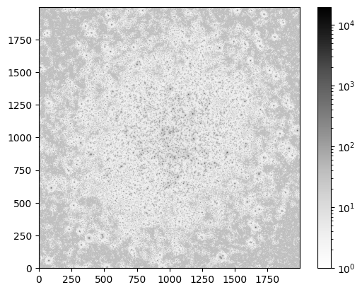

# Astropy Basics

Learning the basics of Astropy by working with real Hubble (HST) and James Webb (JWST) images.



*A 2000 × 2000 pixel region around the centre of the globular cluster NGC 1261 (HST WFC3/UVIS, F275W filter, log scale).*

## Notebooks

| Notebook | What it does |
|----------|--------------|
| `Handling_HST _FITS_BASICS.ipynb` | Open an HST FITS image of NGC 1261 (ACS, F814W), plot it, use WCS, find stars and measure their brightness |
| `JWST_FITS_FILE.ipynb` | Open a JWST NIRCam (F444W) image, check for NaN pixels, plot it with WCS and ZScale |
| `ATTEMPT_CMD_NGC1261.ipynb` | First attempt at the CMD (F275W, F336W). Used the header `EXPTIME` in the magnitude formula instead of the exposure time from the file name, so the magnitudes are wrong |
| `Corrected_CMD_NGC1261.ipynb` | Corrected CMD: measures stars in F275W and F336W, matches them, and plots the colour–magnitude diagram using the exposure time from the file name (e.g. 859 s for `stack-0859s`) |

## Data

HST images of NGC 1261 are from the HUGS survey: https://archive.stsci.edu/prepds/hugs

The notebooks were run in Google Colab, with the FITS files kept in Google Drive.

## Basic Astropy things used

**1. Open a FITS file and look inside**
```python
from astropy.io import fits
fits_file = fits.open('image.fits')
fits_file.info()               # what is inside the file
data = fits_file[0].data       # the image as a numpy array
header = fits_file[0].header   # extra information (filter, exposure time, ...)
```

**2. Plot the image and zoom in**
```python
plt.imshow(data, origin='lower', cmap='Greys', norm=LogNorm())
section = data[4000:6000, 4000:6000]     # zoom by slicing the array
```

**3. WCS: pixels to sky coordinates (RA, Dec)**
```python
from astropy.wcs import WCS
wcs = WCS(header)
plt.subplot(projection=wcs)
```

**4. Find the background level** (stars are removed by sigma clipping)
```python
from astropy.stats import sigma_clipped_stats
mean, median, std = sigma_clipped_stats(section, sigma=3.0)
```

**5. Find stars** (`photutils`)
```python
from photutils.detection import DAOStarFinder
daofind = DAOStarFinder(fwhm=3.0, threshold=5.0*std)
sources = daofind(section - median)
```

**6. Measure brightness with aperture photometry** (`photutils`)
A circle collects the light of the star, a ring around it measures the background.
```python
apertures = CircularAperture(positions, r=6.0)
annulus   = CircularAnnulus(positions, r_in=10, r_out=15)
star_data = aperture_photometry(section, apertures)
```

**7. Convert flux to magnitude**
```
magnitude = zeropoint - 2.5 * log10(net_flux / exposure_time)
```

**8. Colour–magnitude diagram**
```python
colour = mag_F275W - mag_F336W
plt.scatter(colour, mag_F275W)
plt.gca().invert_yaxis()     # brighter stars (smaller magnitude) at the top
```

## Note on exposure time (HUGS stacks)

The header keyword `EXPTIME` is the *total* exposure time of all images in the stack. HUGS stacks are scaled to the exposure time written in the file name (for example, `stack-0859s` means 859 s), so that is the time used in the magnitude formula.

**What changed between the two notebooks:**

- **`ATTEMPT_CMD_NGC1261.ipynb` (incorrect):** used the header `EXPTIME` value, or an average of the individual exposure times, instead of the 859 s from the file name. This gave wrong instrumental magnitudes.
- **`Corrected_CMD_NGC1261.ipynb`(correct):** uses the exposure time from the file name (e.g. 859 s for `stack-0859s`), which matches how HUGS scales its stacks.

## Requirements

```bash
pip install astropy photutils scipy matplotlib numpy
```

---

**Contributed by** Tarun Kumar
